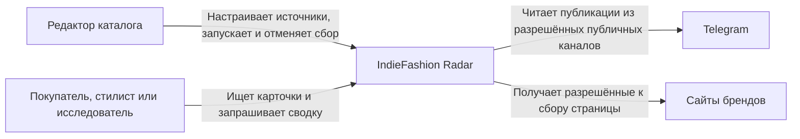
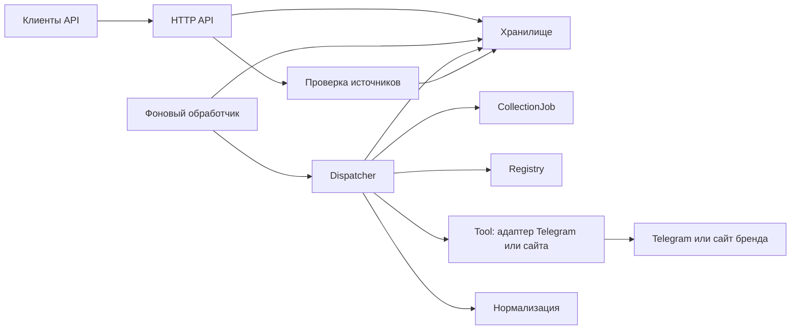
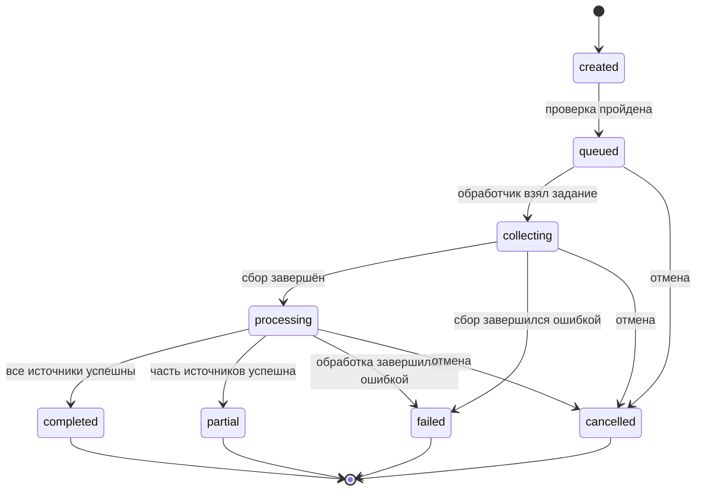

# Архитектура IndieFashion Radar

## Контекст

Стрелки показывают вызовы и действия: от инициатора к системе, с которой он взаимодействует.

## Компоненты

Стрелки показывают вызовы, чтение или запись со стороны инициатора. Registry возвращает Dispatcher подходящий Tool.

| Компонент | За что отвечает и что скрывает |
|---|---|
| HTTP API | Принимает запросы, проверяет права и формат, переводит ошибки в HTTP-ответы. Скрывает HTTP от доменной логики. |
| Проверка источников | Проверяет допустимость источника до запуска сбора. Скрывает правила допуска от Dispatcher. |
| Фоновый обработчик | Берёт задания из очереди и передаёт их Dispatcher. Скрывает планирование запуска от HTTP API. |
| Dispatcher | Выбирает Tool, собирает итоги источников и завершает Job. Скрывает порядок обработки от HTTP API. |
| CollectionJob | Разрешает только допустимые переходы. Скрывает правила смены статуса от вызывающих компонентов. |
| Registry | Находит Tool по типу источника. Скрывает выбор конкретной реализации от Dispatcher. |
| Tool | Получает публикации через Telegram или сайт. Скрывает протокол, формат источника и ограниченные повторы запроса. |
| Нормализация | Приводит записи к Fashion Item и объединяет явные дубликаты. Скрывает правила преобразования от Dispatcher. |
| Хранилище | Хранит источники, задания и карточки. Скрывает схему данных и запросы от вызывающего кода. |

## Состояния Collection Job

Некорректный запрос отклоняется до создания Job. Любой переход, которого нет на схеме, отклоняется с `invalid_state_transition` без изменения статуса. При попытке отменить терминальное задание HTTP API возвращает `409 job_not_cancellable`. Повторный запуск того же Job не предусмотрен. Для нового сбора создаётся новый Job с новым ключом идемпотентности.

При отмене обработчик прекращает запуск новых адаптеров. Запоздавший ответ уже запущенного адаптера отбрасывается. Проверка статуса и публикация результата выполняются атомарно, чтобы отменённое задание не опубликовало карточки.

## Решения для контракта API

- Job доступен редактору, который его создал. Для чужого и неизвестного идентификатора ответ одинаковый: `404 job_not_found`.
- Создание Job и запись ключа идемпотентности выполняются атомарно. Ключ действует в рамках редактора. Повтор с тем же телом возвращает прежний Job, другое тело с тем же ключом даёт `409`.
- Предлагаемая политика восстановления: после рестарта единственного обработчика сохранённые `queued` снова доступны очереди, а прерванные `collecting` и `processing` переходят в `failed` с причиной `job_interrupted`. Терминальные состояния сохраняются.
